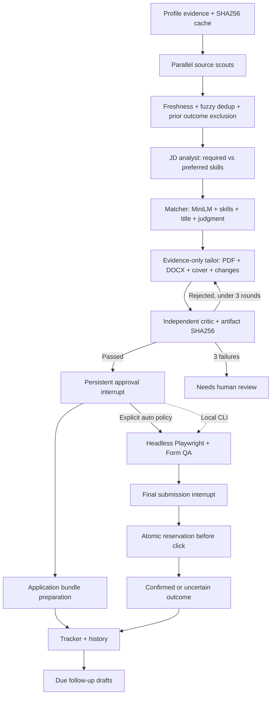

# Lakshya architecture

The parent LangGraph uses a typed serializable state with a separate SQLite
checkpointer. Parallel scouts share domain delays; each source failure has its
own agent trace. Job failures in analysis/tailoring are isolated. Critic failures
loop at most three rounds, then become human-review tasks. CLI stage commands
reuse the same pipeline and can terminate after discovery or matching.

MasterProfile is the immutable evidence contract; internal normalized Job/Profile
models carry scraper and renderer data. API schemas validate status transitions,
run requests, matching configuration and uploads. AgentRun/Event tables persist
stage input/output summaries, tool identity, duration, failures, tokens and costs.
Prompts are versioned package resources and are used in each remote agent call.
Scouts/profile/dedup/orchestrator/tracker/follow-up use deterministic tools;
JD/Matcher/Tailor/Critic route through the selected Gemini or Anthropic provider.
Local processing uses deterministic extraction and critic checks without model API calls.
Per-run/day request and token budgets, pacing and a provider-failure circuit protect
remote usage. No paid fallback is implicit.

A match is 40% semantic, 30% required-skill overlap, 20% title, 10% fit judgment.
Local runs use MiniLM semantic matching and a local judgment baseline; lexical
matching remains selectable. Explicit development demos use lexical matching. Fresher seniority, reliable dates within 24h, location
eligibility and <=2 mandatory years are hard gates regardless of score.

Tailoring selects existing fact IDs and skill order. The renderer copies facts
verbatim, preserves within-section context, fits A4 and generates DOCX plus a
WeasyPrint PDF. ReportLab is used only for preflight height measurement; it does
not produce the submitted PDF. The independent critic examines DOCX paragraphs,
compares PDF/DOCX text, checks one page and validates the plan. Unsupported
candidate claims fail deterministically even if an LLM approves them.

Approval binds the master profile revision, critic report and SHA256 of the whole
bundle. The applier checks the files and profile again before reserving and
clicking. Daily reservations are serialized with SQLite BEGIN IMMEDIATE or a
PostgreSQL advisory lock. Reserved/uncertain outcomes count toward caps and block
retry. Final user confirmation is a second durable LangGraph interrupt while the
visible browser is open. Dry run blocks non-read browser requests throughout.
Unknown questions are never generated. LinkedIn/Naukri submission remains manual.

Email/password accounts use salted scrypt and opaque expiring HttpOnly sessions.
The ASGI account gateway resolves the cookie and routes business requests into a
per-account FastAPI workspace with an internal random API key. Each workspace
owns its configuration, SQLite database, checkpoint, answers, credentials, profile,
output and browser directory. Cookie writes enforce origin checks; login and signup
are rate limited. The owner API key accesses only the separate operator workspace.
Credentials are excluded from responses and never inherited by accounts. Downloads
require an allowed artifact path within that account output directory. SSE uses
same-origin session cookies. React uses React
Router, TanStack Query and Zod, dnd-kit for optimistic board moves, Recharts for
stats and React Flow for workflow activity. Rejected moves restore previous state.

Docker has backend/frontend services and persistent data/output/config volumes.
The default image includes CPU MiniLM and never seeds demo data. Production
rejects explicit demo runs and uses dedicated live volumes. APScheduler runs
hourly within the API lifespan, dispatching through the same single-worker manager
as manual runs. Before resume import it discovers real jobs without a profile;
when setup is ready it prepares bundles. Manual mode interrupts for review; an
explicit automatic policy submits passing hosted ATS forms scoring at least 80.
Browser/profile/document checks and duplicate reservations apply in either mode.
Login, CAPTCHA, consent and unknown answers pause for help. Enabled account
schedulers are restored on server startup. Source
responses are cached according to feed refresh schedules and gates are reevaluated.
Docker includes Chromium for headless auto mode. Visible-browser operations run
in the host graphical session. Caddy in the production override terminates HTTPS
and sessions use Secure cookies on the VPS. The separate CLI
can also run a foreground 09:00 IST daily scheduler.

## Vercel cloud execution

The public frontend and Express gateway route account requests to a private
Python container. A separate private Express service consumes Vercel Queue
messages. Binding URLs and an additional server secret protect the internal
backend; operator keys are never forwarded by browser requests.

Supabase PostgreSQL is authoritative. Authentication uses PostgreSQL, while each account's
SQLite business database, SQLite checkpoint, configuration, evidence, credentials
and artifacts are encrypted with AES-GCM and saved as per-file snapshots.
Every request or queue delivery first takes a distributed session advisory lock,
restores the latest snapshot, executes in `/tmp`, then commits changed files and
follow-up commands atomically. APIs buffer responses until persistence succeeds.
SQLite backup captures committed WAL content. Feed cache modification times are
preserved even when a refreshed response is byte-identical.

One stage executes per queue delivery; another delivery continues its saved graph
checkpoint. Explicit approval interrupts remain durable. Automatic submissions
run separately, one application per delivery, with cloud-flushed reservations
before the external POST. Idempotent commands prevent a redelivery from repeating
completed work. Delayed generation-tagged queue ticks implement hourly searches;
disabling search invalidates old ticks. A daily cron recovers missed outbox work.

Cloud mode uses lexical matching, a maximum of two tailored jobs per search,
4 MB uploads, and a 100 MB workspace quota. Per-account exclusive locks prioritize
correctness and isolation over high throughput. See [VERCEL.md](VERCEL.md) for
runtime limits and deployment-specific queue behavior.

References: [LangGraph interrupts](https://docs.langchain.com/oss/python/langgraph/interrupts),
[LangGraph persistence](https://docs.langchain.com/oss/python/langgraph/persistence),
[Gemini API](https://ai.google.dev/api/generate-content),
[Gemini quotas](https://ai.google.dev/gemini-api/docs/rate-limits),
[Anthropic models](https://platform.claude.com/docs/en/models/overview),
[Anthropic pricing](https://platform.claude.com/docs/en/about-claude/pricing).
